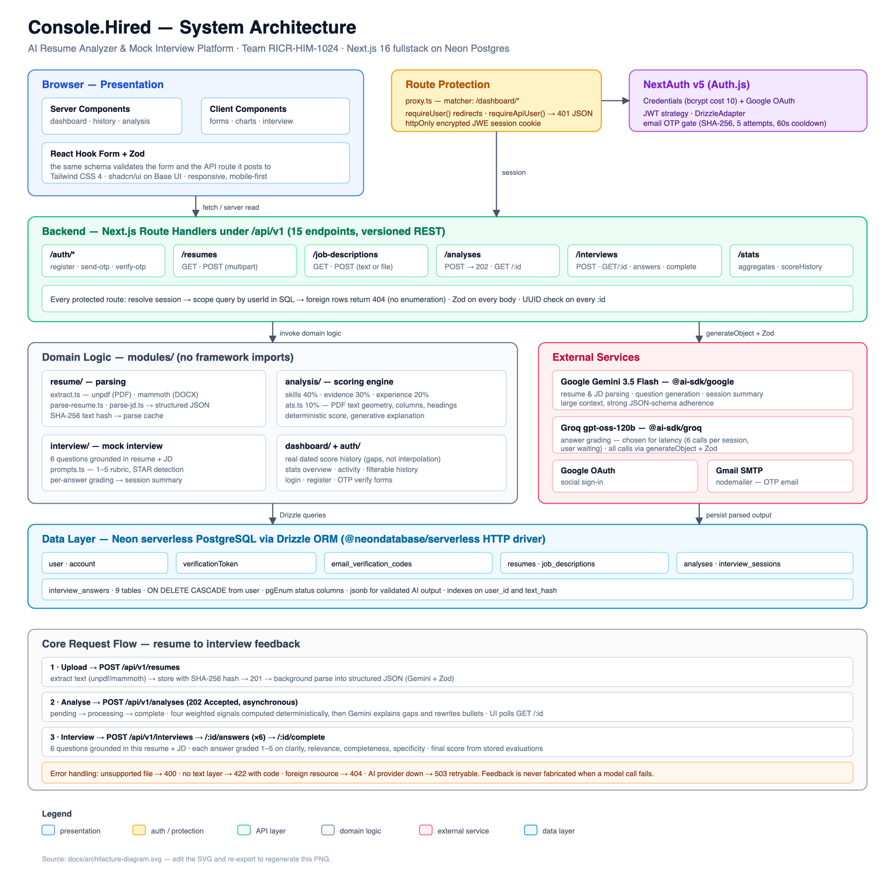

# Console.Hired — AI Resume Analyzer & Mock Interview Platform

> Because every candidate deserves a fair shot — and honest feedback before the real interview.

An AI career coach that tells you whether your resume actually matches a job, exactly what is
missing, and then interviews you on it — grading every answer against a rubric.

- **Team Code:** RICR-HIM-1024
- **Team Name:** Console.log("Winners")
- **Theme:** Career & Job Tech
- **Hackathon:** HackInMotion 2026 (12–15 August 2026)

## Table of Contents

- [Team Members](#team-members)
- [Problem Statement](#problem-statement)
- [Solution Overview](#solution-overview)
- [Technology Stack](#technology-stack)
- [Third-Party AI Services — What We Used and Why](#third-party-ai-services--what-we-used-and-why)
- [Architecture](#architecture)
- [Project Structure](#project-structure)
- [Installation Guide](#installation-guide)
- [Environment Variables](#environment-variables)
- [Database Details](#database-details)
- [API Documentation](#api-documentation)
- [Testing](#testing)
- [Deployment](#deployment)
- [Future Scope](#future-scope)

## Team Members

| Name             | Role      | GitHub                                       |
| ---------------- | --------- | -------------------------------------------- |
| Shawaiz Siddiqui | Team Lead | [@Shawaiz22](https://github.com/Shawaiz22)   |
| Abu Quatada      | Developer | [@abuquatada](https://github.com/abuquatada) |
| Fahad Khan       | Developer | [@Fahadkhan9](https://github.com/Fahadkhan9) |

Run `git shortlog -sne` to see per-author commit counts. A `.mailmap` maps each member's
multiple git identities (local config vs. GitHub noreply address) onto one canonical entry.

## Problem Statement

Millions of job-seekers are rejected without ever learning why. Resumes are filtered by automated
screening systems before a human reads them, and candidates have no affordable way to find out
whether their resume fits a role — or how they will actually perform in the interview.

Build a full-stack web application where a user can upload a resume and a target job description,
receive a match score with specific and actionable feedback, and then practise through an
AI-driven mock interview that evaluates their answers.

## Solution Overview

Console.Hired turns a resume and a job description into an evidence-backed report, then into a
tailored interview.

**1. Parse, don't just extract.** An uploaded PDF or DOCX is converted to text, then passed
through a language model that returns a _structured_ resume — name, skills with proficiency,
experience, education, projects — validated against a Zod schema. Job descriptions go through the
same pipeline. Parsed output is cached by SHA-256 text hash, so re-uploading the same document
costs nothing.

**2. Score deterministically, explain generatively.** The match score is **not** a single "ask the
LLM for a number" call, which would be unreproducible. Four independent signals are computed and
weighted:

| Signal                     | Weight | What it measures                                                |
| -------------------------- | -----: | --------------------------------------------------------------- |
| Skill coverage             |    40% | Required JD skills present in the resume, with synonym matching |
| Responsibility evidence    |    30% | Whether each JD responsibility has concrete supporting evidence |
| Experience & seniority fit |    20% | Years and seniority against what the role asks for              |
| ATS hygiene                |    10% | Machine-readability of the document itself                      |

The same inputs always produce the same score. The model is then used for what models are good at:
explaining _why_ each gap matters and rewriting specific resume bullets for that role.

**3. Simulate the ATS.** `modules/analysis/utils/ats.ts` inspects the PDF's own text geometry to
detect multi-column layouts, contact details stranded in margins, non-standard section headings,
and text density — the formatting choices that quietly cause rejection.

**4. Interview on the evidence.** Six questions (four technical, two behavioural) are generated
from _this_ resume against _this_ job description, each carrying a `whyAsked` rationale. Candidates can respond via text or continuous voice input (speech-to-text) with built-in voice audio playback (text-to-speech feedback). Answers are graded on clarity, relevance, completeness and specificity, with STAR-structure detection on behavioural answers. Upon completing all questions, candidates experience an interactive multi-stage score calculation loading screen before revealing the full session performance summary.

**5. Live Webcam & Vision Analysis.** During mock interviews, a live webcam feed powered by
MediaPipe **PoseLandmarker** (`@mediapipe/tasks-vision`, `pose_landmarker_lite`) tracks seated
posture, framing and steadiness in real time from nose and shoulder geometry — producing a weighted
presence score and live alignment alerts. It runs **entirely in the browser on-device**: no video is
uploaded, recorded or stored, and only derived numbers ever leave the frame loop.

**6. Track progress honestly.** The dashboard charts real scores against the dates they were
recorded. Where there is no data, the chart shows a gap and the UI says so — nothing is
interpolated or invented.

### Requirement Coverage

| #   | Requirement               | Where it lives                                                               |
| --- | ------------------------- | ---------------------------------------------------------------------------- |
| 1   | Accounts & authentication | `auth.ts`, `modules/auth/`, `app/api/v1/auth/*` — credentials + Google OAuth |
| 2   | Resume upload & parsing   | `modules/resume/utils/extract.ts`, `parse-resume.ts` (unpdf + mammoth)       |
| 3   | JD matching engine        | `modules/analysis/utils/` — skills, evidence, experience, ats, run-analysis  |
| 4   | AI mock interview         | `app/api/v1/interviews/*`, `modules/interview/`                              |
| 5   | Dashboard & history       | `app/dashboard/`, `modules/dashboard/`                                       |
| 6   | Database integration      | `lib/db/schema/` — 9 tables on Neon Postgres via Drizzle                     |
| 7   | Responsive, clean UI      | Tailwind CSS 4 + shadcn/base-ui, mobile-first throughout                     |
| 8   | Error handling            | Typed `ExtractionError`, Zod validation on every input, honest 4xx/5xx JSON  |

## Technology Stack

| Layer        | Choice                                | Why                                                                             |
| ------------ | ------------------------------------- | ------------------------------------------------------------------------------- |
| Framework    | Next.js 16 (App Router), React 19     | One deploy target; server components remove a network hop for data reads        |
| Language     | TypeScript (strict)                   | Shared types across the client/server boundary                                  |
| Styling      | Tailwind CSS 4, shadcn/ui on Base UI  | Accessible primitives without shipping a heavy component runtime                |
| Database     | Neon serverless Postgres              | Relational integrity with cascade deletes; scales to zero between demos         |
| ORM          | Drizzle ORM + drizzle-zod             | SQL-shaped, fully typed, schema and validators derived from one source          |
| Auth         | NextAuth v5 (Auth.js)                 | Credentials + Google in one place; httpOnly encrypted session cookie            |
| AI SDK       | Vercel AI SDK (`ai`)                  | One `generateObject` interface; swap providers without rewriting callers        |
| Vision AI    | MediaPipe (`@mediapipe/tasks-vision`) | Real-time client-side face landmarking, eye contact tracking & posture analysis |
| File parsing | unpdf (PDF), mammoth (DOCX)           | unpdf runs serverless with no native binaries and exposes text geometry         |
| Forms        | React Hook Form + Zod                 | The same schema validates the form and the API route it posts to                |
| Testing      | Jest + Testing Library                | Fast route-handler and unit coverage                                            |
| Tooling      | ESLint, Prettier, Husky, lint-staged  | Every commit is formatted, linted and tested before it lands                    |

## Third-Party AI Services — What We Used and Why

We evaluated four options before choosing. The requirement is a single analysis pipeline, so the
decision came down to structured-output reliability, latency, and cost at hackathon volume.

| Option                                               | Verdict                                                                                                                                     |
| ---------------------------------------------------- | ------------------------------------------------------------------------------------------------------------------------------------------- |
| Dedicated resume-parsing APIs (e.g. Affinda, Sovren) | Rejected — accurate on resumes but cannot score against an arbitrary JD or grade interview answers, so we would still need an LLM alongside |
| Embeddings + cosine similarity only                  | Rejected — yields a similarity number but cannot name _which_ skill is missing or _why_, which is the core requirement                      |
| OpenAI GPT-4o                                        | Strong, but slower and more expensive per call than we needed for six-question grading loops                                                |
| **Google Gemini + Groq (chosen)**                    | Best fit combining high-accuracy document parsing with ultra-fast grading inference                                                         |

**Google Gemini 3.5 Flash** — `@ai-sdk/google`, configured as `extractionModel` in [`lib/ai.ts`](lib/ai.ts) for document parsing, resume extraction, and job description understanding. Chosen for high reasoning precision, broad context windows, and robust JSON schema generation.

**Groq (`openai/gpt-oss-120b`)** — `@ai-sdk/groq`, configured as `evaluationModel` in [`lib/ai.ts`](lib/ai.ts) for real-time interview answer evaluation, STAR framework grading, and overall session summary synthesis. Powered by Groq's LPUs for near-instant 6-question grading loops while the candidate waits.

**Google Gemini (`gemini-embedding-001`)** — `@ai-sdk/google`, configured as `embeddingModel` in [`lib/ai.ts`](lib/ai.ts) for vector text embeddings to support semantic comparison.

**How it is integrated.** Both models are declared once in [`lib/ai.ts`](lib/ai.ts) and consumed
through Vercel AI SDK's `generateObject`, always with a Zod schema — so a malformed model
response is a validation error, never corrupt data in the database. Prompts live beside their
feature (`modules/interview/utils/prompts.ts`). If a call fails, the route returns `503` with a
clear message; it never substitutes canned output for real AI feedback.

## Architecture



Request flow for the core journey:

1. **Upload** — `POST /api/v1/resumes` extracts text (unpdf/mammoth), stores it with a SHA-256
   hash, and kicks off parsing in the background.
2. **Job description** — `POST /api/v1/job-descriptions` accepts pasted text or a file and parses
   it the same way.
3. **Analysis** — `POST /api/v1/analyses` returns `202 Accepted` immediately and runs the scoring
   pipeline asynchronously, moving the row through `pending → processing → complete`. The UI polls
   the status.
4. **Interview** — `POST /api/v1/interviews` generates six grounded questions; each answer is
   graded via `POST /api/v1/interviews/:id/answers`; `POST .../complete` produces the summary.
5. **Dashboard** — server components read the user's history directly from Postgres.

Every protected route resolves the session, then scopes its query by `userId` — ownership is
enforced _in the SQL_, and a row belonging to another user returns `404` rather than `403` so
resource IDs cannot be enumerated.

## Project Structure

The hackathon guideline suggests `frontend/` and `backend/` folders. We deliberately ship a single
Next.js application instead, because the API is served by route handlers in the same project. The
separation is by layer rather than by folder name:

```
HackInMotion-RICR-HIM-1024
├── app/
│   ├── (auth)/                  # login, register, verify  — presentation
│   ├── dashboard/               # dashboard, analyze, interview, history
│   └── api/                     # ── backend ── versioned REST under /api/v1
├── modules/                     # domain logic, framework-agnostic
│   ├── analysis/                # scoring engine: skills, evidence, experience, ats
│   ├── auth/  dashboard/  interview/  resume/
├── lib/
│   ├── db/schema/               # Drizzle schema — the data layer
│   ├── ai.ts                    # model declarations
│   └── auth-helpers.ts          # requireUser (pages) / requireApiUser (routes)
├── components/ui/               # shared design-system primitives
├── __tests__/                   # Jest suites
├── docs/                        # supporting documentation
├── architecture-diagram.png
├── api-documentation.md
└── README.md
```

`modules/` holds no framework imports, so the domain logic could be lifted into a separate
Express or FastAPI service if the product ever needed independent scaling.

## Installation Guide

**Prerequisites:** Node.js 20+, npm, and a Neon (or any) PostgreSQL connection string.

```bash
# 1. Clone
git clone https://github.com/Shawaiz22/HackInMotion-RICR-HIM-1024.git
cd HackInMotion-RICR-HIM-1024

# 2. Install
npm install

# 3. Configure — copy the template and fill in real values
cp .env.example .env.local

# 4. Push the schema to your database
npm run db:push

# 5. Run
npm run dev            # http://localhost:3000
```

### Available Scripts

| Script                | Purpose                                     |
| --------------------- | ------------------------------------------- |
| `npm run dev`         | Start the dev server                        |
| `npm run build`       | Production build                            |
| `npm start`           | Serve the production build                  |
| `npm run lint`        | ESLint                                      |
| `npm run format`      | Prettier write                              |
| `npm test`            | Jest suite                                  |
| `npm run db:push`     | Sync `lib/db/schema` to the database        |
| `npm run db:generate` | Emit versioned SQL migrations to `drizzle/` |
| `npm run db:studio`   | Browse the database at local.drizzle.studio |

## Environment Variables

Copy [`.env.example`](.env.example) to `.env.local`. No secrets are committed — `.gitignore`
excludes `.env*`.

| Variable                       | Required | Purpose                                                                |
| ------------------------------ | :------: | ---------------------------------------------------------------------- |
| `DATABASE_URL`                 |   yes    | Neon Postgres connection string (pooled)                               |
| `AUTH_SECRET`                  |   yes    | Signs/encrypts the NextAuth session cookie (`openssl rand -base64 32`) |
| `GOOGLE_CLIENT_ID`             |   yes    | Google OAuth client ID                                                 |
| `GOOGLE_CLIENT_SECRET`         |   yes    | Google OAuth client secret                                             |
| `GOOGLE_GENERATIVE_AI_API_KEY` |   yes    | Gemini — parsing, question generation, summaries                       |
| `GROQ_API_KEY`                 |   yes    | Groq — interview answer grading                                        |
| `GMAIL_USER`                   |   yes    | Sender address for OTP verification email                              |
| `GMAIL_APP_PASSWORD`           |   yes    | Gmail app password (not the account password)                          |

## Database Details

**Neon serverless PostgreSQL**, accessed with Drizzle ORM over the `@neondatabase/serverless`
HTTP driver. Nine tables; every user-owned row cascades on user delete.

| Table                      | Purpose                                                                     |
| -------------------------- | --------------------------------------------------------------------------- |
| `user`                     | Accounts — name, email, `password_hash`, `emailVerified`, `target_role`     |
| `account`                  | OAuth provider links (Auth.js adapter)                                      |
| `verificationToken`        | Auth.js verification tokens                                                 |
| `email_verification_codes` | Hashed 6-digit OTPs with expiry and attempt counter                         |
| `resumes`                  | Uploaded file, `raw_text`, `text_hash`, `parsed` JSON, `ats_report`         |
| `job_descriptions`         | Title, company, `raw_text`, `text_hash`, `parsed` JSON                      |
| `analyses`                 | Status, `overall_score`, `breakdown`, `evidence_map`, `gaps`, `suggestions` |
| `interview_sessions`       | Generated `questions`, status, `overall_score`, `summary`                   |
| `interview_answers`        | Answer text, `question_index`, `evaluation` JSON, `delivery_metrics`        |

**Design notes.** Structured AI output is stored as `jsonb` and validated by Zod on the way in, so
the shape is guaranteed without a migration per field. Both document tables index `text_hash` to
make parse-result caching a single indexed lookup. `analyses` and `interview_sessions` index
`user_id`, the column every dashboard query filters on. Status columns are Postgres enums rather
than free text, so an invalid state cannot be written.

Passwords are hashed with bcrypt (cost 10) and OTP codes are stored hashed, never in plain text.

## API Documentation

Fifteen endpoints under `/api/v1`. Full request/response shapes, status codes, and authentication
instructions are in **[api-documentation.md](api-documentation.md)**.

A ready-to-run Postman collection is at
[`docs/postman-collection.json`](docs/postman-collection.json) — import it, run the **Login**
request, and every other request is authenticated automatically.

> Authentication uses an httpOnly, encrypted session cookie, not a bearer token. See the
> [Authentication](api-documentation.md#authentication) section for how to authenticate from
> Postman or curl.

## Testing

```bash
npm test
```

Jest with Testing Library covers route-handler contracts (auth gating, upload validation, JD
length limits), OTP hashing and expiry, text extraction, and email dispatch. `__tests__/api-auth.test.ts`
specifically asserts that unauthenticated API calls return `401` JSON rather than a redirect.

## Deployment

**Live:** [console-hired.vercel.app](https://console-hired.vercel.app)

Hosted on Vercel. To reproduce the deployment:

1. Import the repository into Vercel; the Next.js preset needs no build configuration.
2. Set the production branch to the branch that carries the application code.
3. Set every variable from [Environment Variables](#environment-variables) in the project settings.
4. Add the deployed origin as an authorised redirect URI on the Google OAuth client
   (`https://<your-domain>/api/auth/callback/google`).
5. Run `npm run db:push` against the production `DATABASE_URL` so the schema exists before first
   request.

Route handlers that call AI models declare `maxDuration = 60`, which suits Vercel's serverless
function limits. Neon's free tier suspends after roughly five minutes idle, so the first request
after a quiet period is slower while the database wakes.

## Future Scope

- **Tuned similarity thresholds** — skill matching already falls back to `gemini-embedding-001`
  cosine similarity at 0.75, and evidence mapping classifies at 0.70/0.55. Those cut-offs are
  uniform today; calibrating them per industry would reduce false negatives in non-technical roles.
- **Resume rewriter** — generate a full revised resume, not just per-bullet suggestions.
- **Industry-specific question banks** — tailor questions by domain rather than role alone.
- **Shareable feedback reports** — a signed public link a mentor or recruiter can review.
- **Background job queue** — analysis currently runs as fire-and-forget after a `202`; a real
  queue would add retries and durability.
- **Rate limiting** — per-user quotas on AI endpoints before this faces real traffic.

## License

Built for HackInMotion 2026. All rights reserved by the team.
